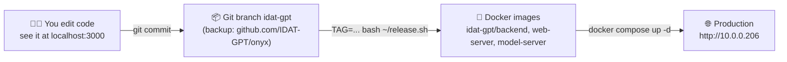

# IDAT-GPT

IDAT-GPT is IDAT's own AI platform. It is a fork of the open-source project
[Onyx](https://github.com/onyx-dot-app/onyx) with our own branding, our own
connector logic, and our own deployment. Colleagues use it in the browser at
**http://10.0.0.206** — chat with LLMs, search company documents, build agents,
and connect tools such as ClickUp or SharePoint.

This document explains how the system works and how to change it. The upstream
Onyx README is in [README.md](README.md).

---

## 1. The big picture

There are **two copies** of IDAT-GPT on the build server (Windows VM `10.0.0.206`):

| Tier | URL | Purpose | Data |
|---|---|---|---|
| **Development** | http://localhost:3000 (on the VM only) | Edit code and see the result in seconds | Own throwaway database |
| **Production** | http://10.0.0.206 (whole network) | Colleagues work here | Own protected database |

The two tiers share the **code**, but never the **data**. An API key, user,
connector, or chat created in one tier does not appear in the other. This is
intentional: you can experiment in development without any risk to colleagues.



---

## 2. Images, containers, volumes — in plain words

Production runs on **Docker** inside a Linux system (Ubuntu on WSL2) that lives
on the Windows VM.

- **Image** = an installation package. Frozen, versioned (`idat-gpt/backend:idat-1.0.0`).
  Built from our source code. Replacing it is how we ship changes.
- **Container** = a running program started from an image. Can be stopped,
  restarted, or replaced at any time without losing data.
- **Volume** = the hard disk of a container. Survives every update and restart.
  All valuable data (users, chats, API keys, indexed documents) lives in volumes.

**Rule of thumb: images carry code, volumes carry data, containers are disposable.**

### The production containers (`docker compose -p idat-gpt ps`)

| Container | Role |
|---|---|
| `nginx` | Front door. Receives all requests on port 80 and routes them |
| `web_server` | The IDAT-GPT user interface (Next.js) |
| `api_server` | The backend API (FastAPI). Runs DB migrations on start |
| `background` | Workers (Celery) that sync connectors and index documents |
| `inference_model_server` / `indexing_model_server` | Run the embedding models for search |
| `relational_db` | PostgreSQL — users, chats, settings, connector configs |
| `opensearch` | Search index over all connected documents |
| `cache` | Redis — queues and caching |
| `minio` | File storage (uploads, generated files) |
| `code-interpreter` | Sandbox for the "run code" feature |

### The three images we build ourselves

| Image | Built from | Used by |
|---|---|---|
| `idat-gpt/backend:<tag>` | `backend/Dockerfile` | `api_server`, `background` |
| `idat-gpt/web-server:<tag>` | `web/Dockerfile` | `web_server` |
| `idat-gpt/model-server:<tag>` | `backend/Dockerfile.model_server` | both model servers |

Everything else (Postgres, OpenSearch, Redis, MinIO, nginx) uses unmodified
public images.

---

## 3. How to make a change — all steps

### Step 0 — one-time: make sure the dev tier runs

On the Windows VM: `powershell C:\Users\GPT-Admin\onyx-dev.ps1 infra` then
`...\onyx-dev.ps1 up`. Open http://localhost:3000.

### Step 1 — edit the code

The source is at `C:\Users\GPT-Admin\onyx` (branch `idat-gpt`).
Frontend code: `web/src`. Backend code: `backend/onyx`. Connectors:
`backend/onyx/connectors/<name>/`.

### Step 2 — see the change immediately

Save the file. The dev tier reloads by itself. Check http://localhost:3000.

### Step 3 — test

```bash
# backend example
cd backend && python -m pytest tests/unit/onyx/connectors/clickup -q
# frontend example (run Jest with node, not bun)
cd web && node node_modules/jest/bin/jest.js <changed test files>
```

### Step 4 — commit and push (backup)

```bash
git add -A
git commit -m "short description of the change"
git push fork idat-gpt
```

### Step 5 — release to production

Open the Linux side (`wsl -d Ubuntu`) and run **one command** with a new
version tag:

```bash
TAG=idat-1.1.0 bash ~/release.sh
```

The script: clones the **committed** code → builds the three images → keeps the
production secrets (`~/idat-gpt.env`) → points the stack at the new tag →
`docker compose up -d`. Only changed containers restart. **Data is untouched.**

### Step 6 — verify

Open http://10.0.0.206 and check your change. Done.

### Rollback

Rerun the release with the previous tag: `TAG=idat-1.0.0 bash ~/release.sh`.
Old images stay cached, so this takes seconds.

---

## 4. Operating production

All commands run inside `wsl -d Ubuntu`, from
`~/onyx-build/deployment/docker_compose`:

| Task | Command |
|---|---|
| Status of all containers | `docker compose -p idat-gpt ps` |
| Follow the API logs | `docker compose -p idat-gpt logs -f api_server` |
| Restart one service | `docker compose -p idat-gpt restart api_server` |
| Stop / start everything | `docker compose -p idat-gpt stop` / `start` |
| Backup the database | `docker exec idat-gpt-relational_db-1 pg_dump -U postgres postgres > backup.sql` |

Or use **Portainer** (web dashboard for the same information):
https://localhost:9443 on the VM.

### Important files on the server

| Path | Content |
|---|---|
| `C:\Users\GPT-Admin\onyx` | The source code (git, branch `idat-gpt`) |
| WSL `~/release.sh` | The build + deploy script |
| WSL `~/idat-gpt.env` | **Production secrets. Never delete. Never commit.** |
| WSL `~/onyx-build` | Disposable build checkout (recreated on each release) |
| Docker volumes `idat-gpt_*` | All production data |

### How the network path works

Windows forwards port 80 of the VM's address (`10.0.0.206`) into the Linux
system (a `netsh portproxy` rule plus a firewall rule, both persistent).
Inside Linux, nginx receives the request and routes it to the app.

---

## 5. If the server is down — recovery

What survives a reboot on its own: the port-forward, the firewall rule, and
**all data** (Docker volumes). Docker and every container start automatically —
as soon as the Linux system (WSL) starts. WSL itself is the only piece that
needs a push.

### Recovery in one command

Log on to the VM (`10.0.0.206`) and run:

```powershell
powershell -ExecutionPolicy Bypass -File C:\Users\GPT-Admin\start-idat-gpt.ps1
```

The script starts WSL, keeps it alive, starts anything missing, waits for the
health check, and prints **"IDAT-GPT is UP"** (2–3 minutes). It is safe to run
at any time.

### Automatic recovery

- A Startup entry (`idat-gpt-autostart.cmd` in the Startup folder of
  `GPT-Admin`) runs this script automatically at every **logon**.
- For recovery at **boot** (nobody has to log on), run once in an
  *Administrator* PowerShell:

  ```powershell
  schtasks /create /tn "IDAT-GPT autostart" /tr "powershell -ExecutionPolicy Bypass -File C:\Users\GPT-Admin\start-idat-gpt.ps1" /sc onstart /ru SYSTEM /rl highest
  ```

### App answers wrong / one container broken (server itself fine)

```bash
wsl -d Ubuntu
docker compose -p idat-gpt ps                      # what is Exited/unhealthy?
docker compose -p idat-gpt logs --tail 100 <name>  # read the error
docker compose -p idat-gpt up -d                   # recreate what is missing
```

Or use Portainer: https://localhost:9443 on the VM.

### Backups (automatic)

Every night at 02:00 a cron job inside Ubuntu writes a database dump and a copy
of the secrets file to `C:\Users\GPT-Admin\idat-backups\` and keeps the newest
14 (`~/idat_backup.sh`, log: `backup.log`). Together with the code on GitHub,
these files are enough to rebuild IDAT-GPT on any new machine:
database dump + `idat-gpt.env` + `git clone` → build → restore.
Copy that folder to a network share regularly — backups on the same
machine do not protect against a dead disk.

### Total loss of the VM

1. New machine with Docker (any Linux, or Windows+WSL like today).
2. `git clone https://github.com/IDAT-GPT/onyx -b idat-gpt`
3. Restore `idat-gpt.env`, build (`release.sh`), start the stack.
4. Restore the database dump into `relational_db`
   (`gunzip -c db-<date>.sql.gz | docker exec -i <db-container> psql -U postgres`).
5. Documents re-index themselves from the connectors.

---

## 6. Getting updates from the original Onyx project

Our fork can absorb upstream improvements:

```bash
git fetch origin                 # origin = onyx-dot-app/onyx (upstream)
git merge origin/main            # merge into idat-gpt, resolve conflicts
python tools/rebrand/rebrand.py  # rebrand any new "Onyx" strings
cd web && SCRATCH=/tmp bun ../tools/rebrand/gen_assets.mjs   # only if logos changed upstream
# test on localhost:3000, then release as usual (step 5)
```

`tools/rebrand/README.md` has the details.

---

## 7. FAQ

**I added an LLM key / connector in dev. Why is production unchanged?**
Keys and connectors are *data*, stored in each tier's own database. Configure
production at http://10.0.0.206/admin. Only *code* moves through the release.

**Does a release delete chats or users?**
No. Data lives in Docker volumes; a release only swaps the code images.

**Who is admin?**
The first registered account, plus anyone promoted in the admin panel.

**Something is down. First checks?**
1. `docker compose -p idat-gpt ps` — is a container `Exited`/`unhealthy`?
2. `docker compose -p idat-gpt logs --tail 100 <service>` — read the error.
3. `docker compose -p idat-gpt up -d` — recreate what is missing.

---

## 8. Related repositories

IDAT-GPT is one of three repositories that make up the platform. All live on
the **IDAT-GPT** GitHub account.

| Repository | What it is |
|---|---|
| **IDAT-GPT/onyx** (this one) | The AI platform itself — chat, document search, agents, connectors. Fork of [onyx-dot-app/onyx](https://github.com/onyx-dot-app/onyx). Our work is on branch `idat-gpt`. |
| [IDAT-GPT/idat-crm](https://github.com/IDAT-GPT/idat-crm) | The semantic model of the CRM database `idatdata`, plus the scripts that export tickets and bugs into the SharePoint folders this platform indexes. |
| [IDAT-GPT/WrenAI](https://github.com/IDAT-GPT/WrenAI) | Fork of the Wren engine that serves that model over MCP at `http://10.0.0.206:8081/mcp`. |

### How they fit together

```
IDAT-GPT (this repo)  ──asks──▶  wren MCP :8081  ──reads──▶  MySQL idatdata
   │                             (IDAT-GPT/WrenAI serving IDAT-GPT/idat-crm)
   └──indexes──▶  SharePoint folders
                  (filled by idat-crm/tools/*, see that repo's README §6)
```

**One thing worth knowing when adding SharePoint content:** our SharePoint
connector attaches no per-document metadata, so *the folder is the only
retrieval filter that exists*. Split folders as finely as you will ever want to
filter, then compose upward — `Folder → Connector → DocumentSet → Assistant`.
`.md` is indexed natively, so there is no reason to convert exports to PDF.
